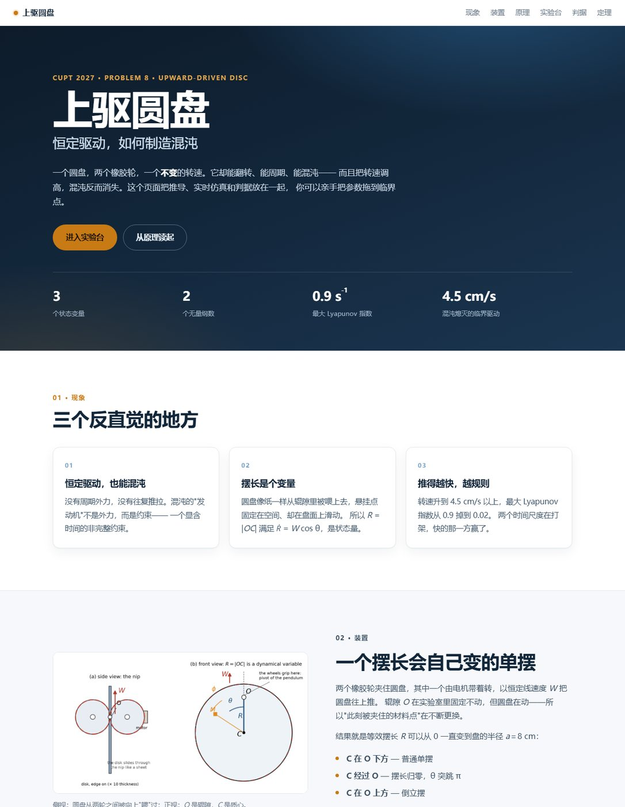

# 上驱圆盘 · 交互式物理实验室

> 一个圆盘，两个橡胶轮，一个**不变**的转速。它却能翻转、能周期、能混沌——
> 而且把转速调高，混沌反而消失。

CUPT 2027 / IYPT Problem 8 "Upward-driven disc" 的可交互解读：
左边是实时装置动画，右边是相图，下面拖滑块就能看着最大 Lyapunov 指数
从 0.76 掉到 0.02。所有曲线都是浏览器里**当场积分**出来的，不是查表。



## 三个可以立刻试的事情

1. **把「驱动速度」从 1.4 拖到 7.0** —— 看右下角的 λ 从约 0.76 掉到 0.02，
   相图从"填满一片"变成"几条闭合曲线"。这就是本项目的主结论。
2. **把「初始偏移」拖到 0** —— 圆盘会笔直上升，直到被推出辊隙。
   对称解是精确解，但它不稳定。
3. **点「清空轨迹」** —— 相图会重新长出来，能看清吸引子的形状。

## 物理：三个方程，两个无量纲数

```
Ẏ = Z·Ω
Ż = W − Y·Ω
Ω̇ = (gY − kΩ − W·Z·Ω) / (Y² + Z² + I_C)
```

`W` 驱动速度，`k` 阻尼，`I_C = a²/2` 是圆盘绕质心的转动惯量。
无量纲化后只剩两个数：`w = W/√(ga)`、`κ = k/(a√(ga))`。

关键的一句话：**驱动不在方程的右边，而在速度约束里**。
轮子抓住盘不打滑，等价于「此刻位于辊隙的那个材料点必须以 W 上行」，
这是一个显含时间的非完整约束——混沌正是从这种约束里长出来的，不是从周期性外力。

### 一个否定性定理

文献里那个「匀速自转一个多小时」的状态，平衡点确实存在
（`Y₀² = kW/g`，`Ω₀ = W/Y₀`），但线性化后用 Routh–Hurwitz 判据：

```
mp − q = −(κw²/D₀ + ω₀ŷ₀)/D₀ < 0    对任意 w, κ, γ > 0 成立
```

**只要摩擦力矩只依赖 Ω，它就恒不稳定。** 线性的、二次的、库仑的、
带静摩擦阈值的阻尼全都救不了它——唯一的方向是让约束本身允许打滑。

## 结构

```
index.html          单页：现象 / 装置 / 原理 / 实验台 / 判据 / 定理 / 边界
css/style.css
js/physics.js       ODE + RK4 + Benettin Lyapunov
js/render.js        三个 canvas：装置视图 / 相图 / λ(W) 曲线
js/app.js           滑块、预设、动画循环
js/data.js          离线算好的 λ(W) 扫描（46 点 × 260 s）
assets/             图与公式（300 dpi）
```

## 本地运行

双击 `index.html`。没有构建、没有依赖、不联网。

因为刻意不用 ES module / fetch / Worker，`file://` 协议下也不会被 CORS 拦，
拷到 U 盘里就能演示。

## 部署

推到仓库根目录后，Settings → Pages → Source 选 `Deploy from a branch`，
分支 `main`、目录 `/ (root)`，一两分钟后得到：

```
https://<你的用户名>.github.io/<仓库名>/
```

## 引用

L. Maas, *The upward-driven disk, a steadily forced chaotic pendulum*,
Am. J. Phys. **93**, 620 (2025). arXiv:2505.17957

数值结果与图表均由本人用 Python（numpy / scipy / matplotlib）生成，
网页端的物理与 Python 版已对拍（λ = 0.746 / 0.76，R 范围一致）。
